# Mapa de flujo y llamadas — CineStarBD

> Cómo se ocupan unas a otras las funciones, tanto **dentro de un mismo archivo** como **entre archivos**.
> Los diagramas están en Mermaid: se renderizan automáticamente en GitHub, VS Code (extensión Mermaid) o cualquier visor Markdown.
> Referencias: `Program.cs`, `Dominio\*.cs`, `Presentacion\FormCine.cs`, `Presentacion\FormCine.Designer.cs`.

---

## 1. Mapa de dependencias entre archivos (quién conoce a quién)

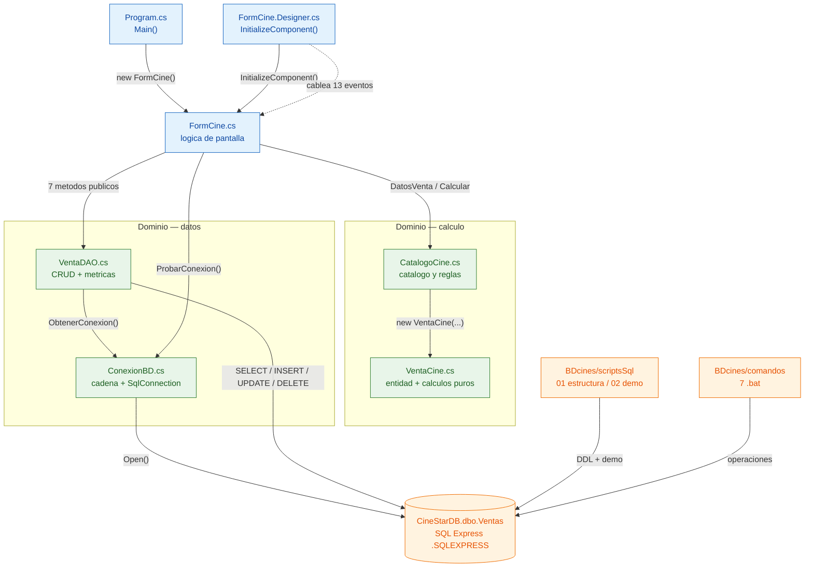

**Regla de oro:** `FormCine` nunca abre una conexión. Todo pasa por `VentaDAO` → `ConexionBD`. `CatalogoCine` y `VentaCine` no conocen ni WinForms ni SQL.

---

## 2. Grafo de llamadas dentro de `FormCine.cs` (mismo archivo)

Para que las flechas no se apelotonen, el grafo se divide en tres momentos. Todos usan `nodeSpacing`/`rankSpacing` amplios y curva `basis`, que abre ángulo entre las líneas.

### 2.1 Carga inicial

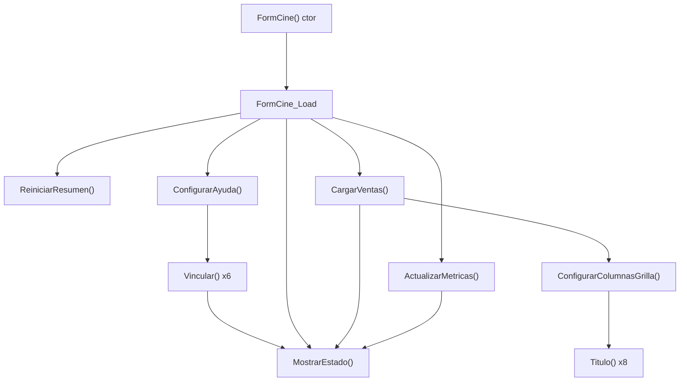

### 2.2 Cálculo en vivo

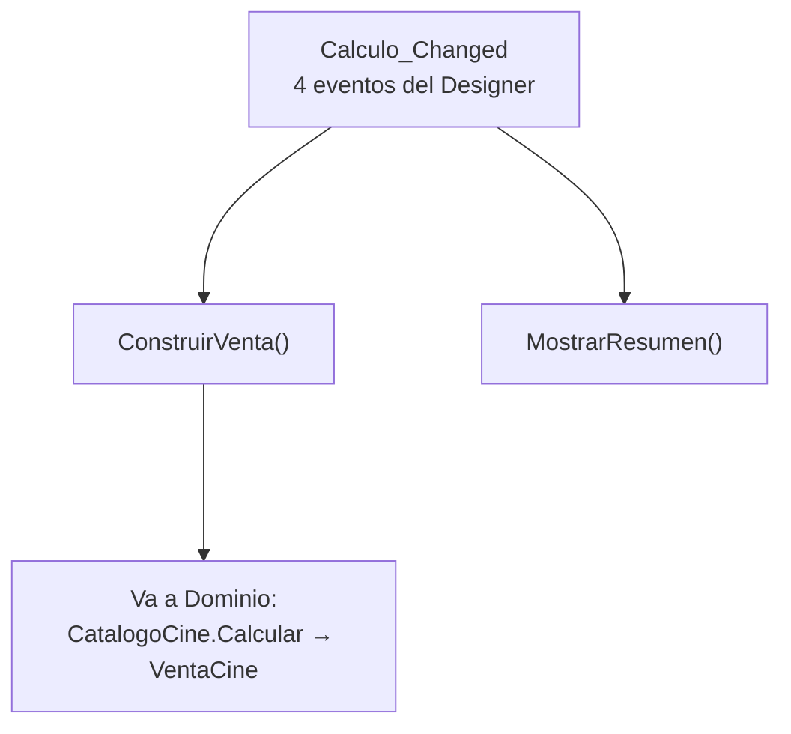

> El salto a Dominio se detalla en el apartado 3.1.

### 2.3 Acciones del usuario (botones y grilla)

> Diagrama **horizontal y ampliado**. En el visor Markdown se recorre con la barra de desplazamiento lateral; en el PDF ocupa una página apaisada para que se lea grande.

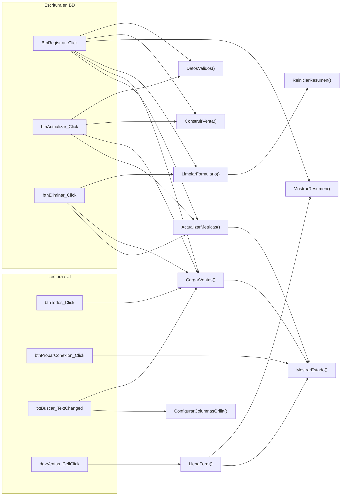

**Observación:** `MostrarEstado` sigue siendo el nodo sumidero, pero al quedar a la derecha y con `rankSpacing` de 180, las flechas llegan desde ángulos muy distintos en vez de apilarse. `CargarVentas` y `ActualizarMetricas` se repiten tras registrar / actualizar / eliminar.

---

## 3. Grafo de llamadas hacia `Dominio` (entre archivos)

Igual que en el apartado 2: dos grafos verticales en vez de uno horizontal, para que cada rama tenga su propio carril.

### 3.1 Dominio — cálculo puro (sin SQL)

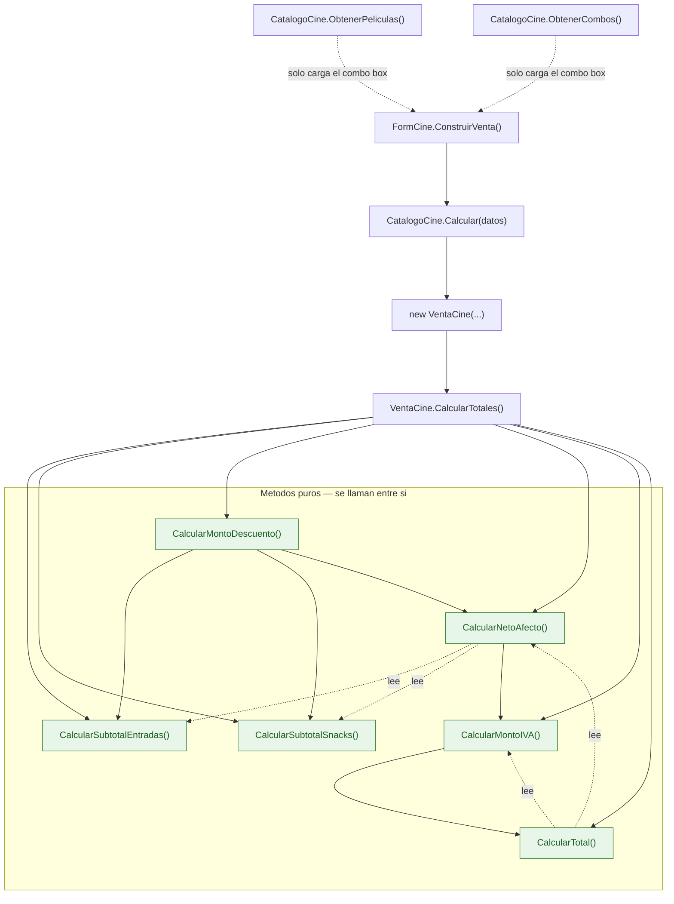

> Las líneas discontinuas son **lecturas** de valores ya calculados, no llamadas de control: por eso se dibujan aparte y no cruzan el árbol principal.

### 3.2 Dominio — persistencia (DAO → conexión → BD)

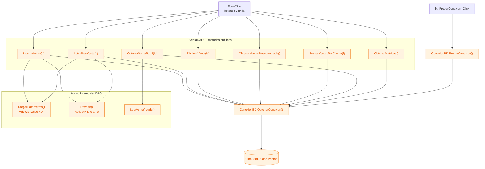

---

## 4. Secuencias de los flujos principales

### 4.1 Arranque de la pantalla (`FormCine_Load`)

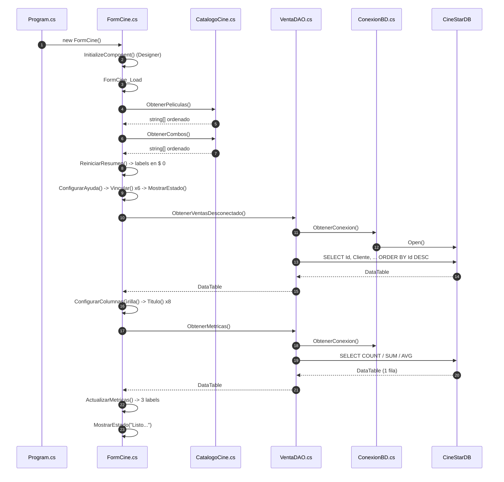

### 4.2 Cálculo en vivo (`Calculo_Changed`)

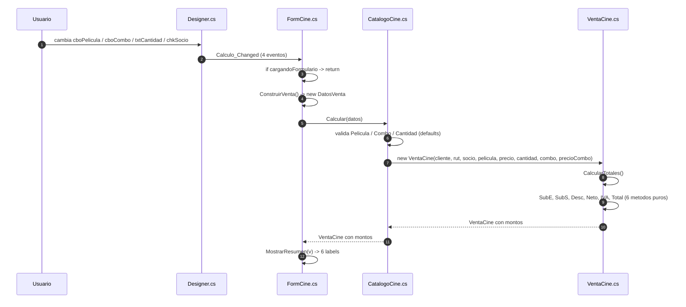

### 4.3 Registrar una venta (`BtnRegistrar_Click`)

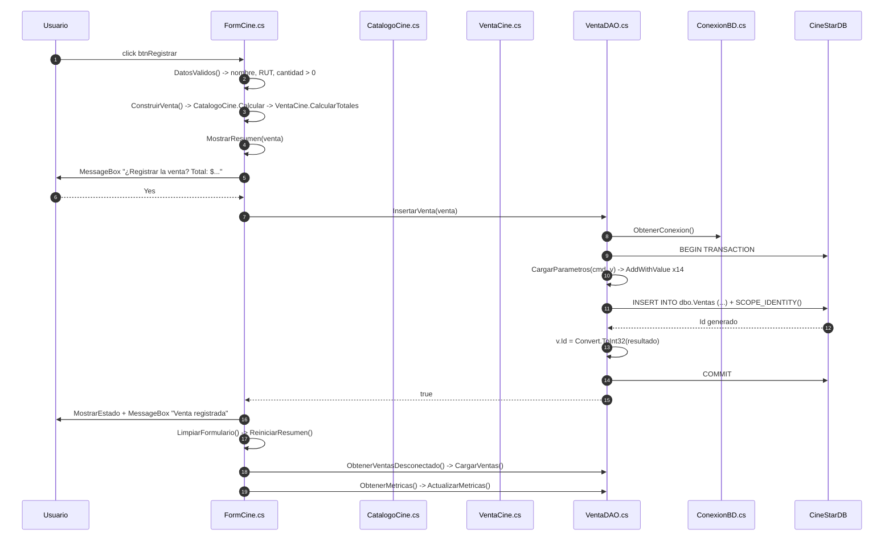

> Si falla: `Revertir(tran)` → `Rollback()` tolerante y la excepción se propaga al `catch` del botón.

### 4.4 Actualizar / Eliminar / Buscar

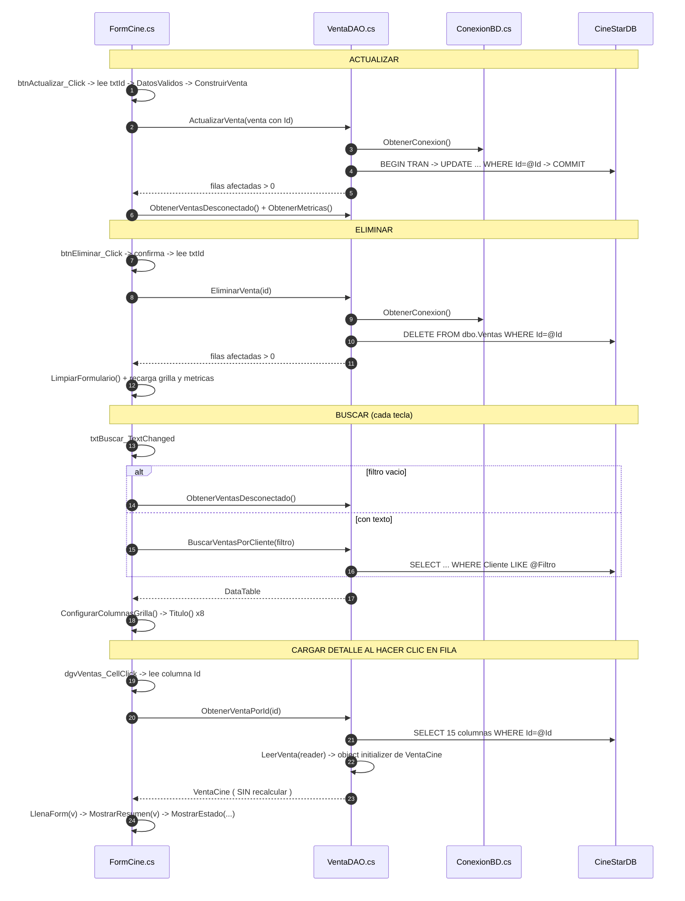

### 4.5 Prueba de conexión

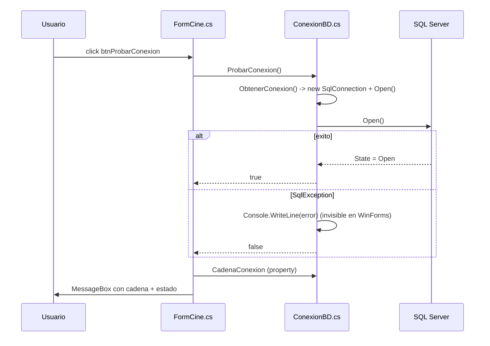

---

## 5. Tabla de trazabilidad (función → llamada desde → llama a)

| Función | Archivo | Llamada desde | Llama a |
|---|---|---|---|
| `Main()` | `Program.cs` | Windows | `Application.Run(new FormCine())` |
| `FormCine()` | `FormCine.cs` | `Program.Main` | `InitializeComponent()` |
| `FormCine_Load` | `FormCine.cs` | Designer (`Load`) | `ObtenerPeliculas`, `ObtenerCombos`, `ReiniciarResumen`, `ConfigurarAyuda`, `CargarVentas`, `ActualizarMetricas`, `MostrarEstado` |
| `ConstruirVenta` | `FormCine.cs` | `Calculo_Changed`, `BtnRegistrar`, `btnActualizar` | `CatalogoCine.DatosVenta`, `CatalogoCine.Calcular` |
| `Calculo_Changed` | `FormCine.cs` | Designer (4 eventos) | `ConstruirVenta`, `MostrarResumen` |
| `MostrarResumen` | `FormCine.cs` | `Calculo_Changed`, `BtnRegistrar`, `LlenaForm` | 6 labels |
| `DatosValidos` | `FormCine.cs` | `BtnRegistrar`, `btnActualizar` | `MessageBox`, `Focus()` |
| `BtnRegistrar_Click` | `FormCine.cs` | Designer (`Click`) | `DatosValidos`, `ConstruirVenta`, `MostrarResumen`, `VentaDAO.InsertarVenta`, `LimpiarFormulario`, `CargarVentas`, `ActualizarMetricas`, `MostrarEstado` |
| `btnActualizar_Click` | `FormCine.cs` | Designer (`Click`) | `DatosValidos`, `ConstruirVenta`, `VentaDAO.ActualizarVenta`, `CargarVentas`, `ActualizarMetricas` |
| `btnEliminar_Click` | `FormCine.cs` | Designer (`Click`) | `VentaDAO.EliminarVenta`, `LimpiarFormulario`, `CargarVentas`, `ActualizarMetricas` |
| `btnTodos_Click` | `FormCine.cs` | Designer (`Click`) | `CargarVentas`, `MostrarEstado` |
| `btnProbarConexion_Click` | `FormCine.cs` | Designer (`Click`) | `ConexionBD.ProbarConexion`, `CadenaConexion`, `MostrarEstado` |
| `btnSalir_Click` | `FormCine.cs` | Designer (`Click`) | `Close()` |
| `txtBuscar_TextChanged` | `FormCine.cs` | Designer (`TextChanged`) | `ObtenerVentasDesconectado` o `BuscarVentasPorCliente`, `ConfigurarColumnasGrilla` |
| `CargarVentas` | `FormCine.cs` | 5 lugares | `VentaDAO.ObtenerVentasDesconectado`, `ConfigurarColumnasGrilla`, `MostrarEstado` |
| `ConfigurarColumnasGrilla` | `FormCine.cs` | `CargarVentas`, `txtBuscar_TextChanged` | `Titulo` ×8 |
| `dgvVentas_CellClick` | `FormCine.cs` | Designer (`CellClick`) | `VentaDAO.ObtenerVentaPorId`, `LlenaForm` |
| `LlenaForm` | `FormCine.cs` | `dgvVentas_CellClick` | `MostrarResumen`, `MostrarEstado` |
| `LimpiarFormulario` | `FormCine.cs` | `BtnRegistrar`, `btnEliminar` | `ReiniciarResumen` |
| `ActualizarMetricas` | `FormCine.cs` | 4 lugares | `VentaDAO.ObtenerMetricas`, `MostrarEstado` |
| `ConfigurarAyuda` | `FormCine.cs` | `FormCine_Load` | `Vincular` ×6 |
| `Vincular` | `FormCine.cs` | `ConfigurarAyuda` | `MostrarEstado` (lambdas MouseEnter/Leave) |
| `MostrarEstado` | `FormCine.cs` | casi todos | actualiza `lblAyuda` |
| `CatalogoCine.Calcular` | `CatalogoCine.cs` | `ConstruirVenta` | valida diccionarios → `new VentaCine(...)` |
| `ObtenerPeliculas` / `ObtenerCombos` | `CatalogoCine.cs` | `FormCine_Load` | `Keys.OrderBy().ToArray()` |
| `VentaCine` ctor | `VentaCine.cs` | `CatalogoCine.Calcular`, `VentaDAO.LeerVenta` | `CalcularTotales()` (solo el ctor sobrecargado) |
| `CalcularTotales` | `VentaCine.cs` | ctor sobrecargado | los 6 métodos puros |
| `CalcularMontoDescuento` | `VentaCine.cs` | `CalcularTotales` | `CalcularSubtotalEntradas`, `CalcularSubtotalSnacks` |
| `CalcularNetoAfecto` | `VentaCine.cs` | `CalcularTotales` | `SubE`, `SubS`, `Descuento` |
| `CalcularMontoIVA` | `VentaCine.cs` | `CalcularTotales` | `CalcularNetoAfecto` |
| `CalcularTotal` | `VentaCine.cs` | `CalcularTotales` | `Neto`, `IVA` |
| `InsertarVenta` | `VentaDAO.cs` | `BtnRegistrar_Click` | `ObtenerConexion`, `CargarParametros`, `Revertir`, `Commit` |
| `ActualizarVenta` | `VentaDAO.cs` | `btnActualizar_Click` | `ObtenerConexion`, `CargarParametros`, `Revertir`, `Commit` |
| `EliminarVenta` | `VentaDAO.cs` | `btnEliminar_Click` | `ObtenerConexion` |
| `ObtenerVentasDesconectado` | `VentaDAO.cs` | `CargarVentas`, `txtBuscar` | `ObtenerConexion`, `SqlDataAdapter.Fill` |
| `BuscarVentasPorCliente` | `VentaDAO.cs` | `txtBuscar_TextChanged` | `ObtenerConexion`, `LIKE @Filtro` |
| `ObtenerVentaPorId` | `VentaDAO.cs` | `dgvVentas_CellClick` | `ObtenerConexion`, `LeerVenta` |
| `ObtenerMetricas` | `VentaDAO.cs` | `ActualizarMetricas` | `ObtenerConexion`, `COUNT/SUM/AVG` |
| `CargarParametros` | `VentaDAO.cs` | `InsertarVenta`, `ActualizarVenta` | `AddWithValue` ×14 |
| `LeerVenta` | `VentaDAO.cs` | `ObtenerVentaPorId` | `new VentaCine { ... }` (object initializer) |
| `Revertir` | `VentaDAO.cs` | `InsertarVenta`, `ActualizarVenta` | `tran.Rollback()` |
| `ObtenerConexion` | `ConexionBD.cs` | los 7 métodos del DAO + `ProbarConexion` | `SqlConnection.Open()` |
| `ProbarConexion` | `ConexionBD.cs` | `btnProbarConexion_Click` | `ObtenerConexion`, `Console.WriteLine` si falla |
| `CadenaConexion` | `ConexionBD.cs` | `btnProbarConexion_Click` | devuelve `cadenaConexion` |
| `InitializeComponent` | `FormCine.Designer.cs` | ctor de `FormCine` | crea controles y cablea 13 eventos |

---

## 6. Resumen en una frase

> `Program` llama a `FormCine`; el Designer le inyecta 13 eventos; `FormCine` calcula con `CatalogoCine` + `VentaCine` y persiste vía `VentaDAO`; el DAO abre conexiones con `ConexionBD` y habla con `CineStarDB`; después de cada escritura, `FormCine` vuelve a llamar a `CargarVentas` y `ActualizarMetricas`, y termina siempre en `MostrarEstado`.
